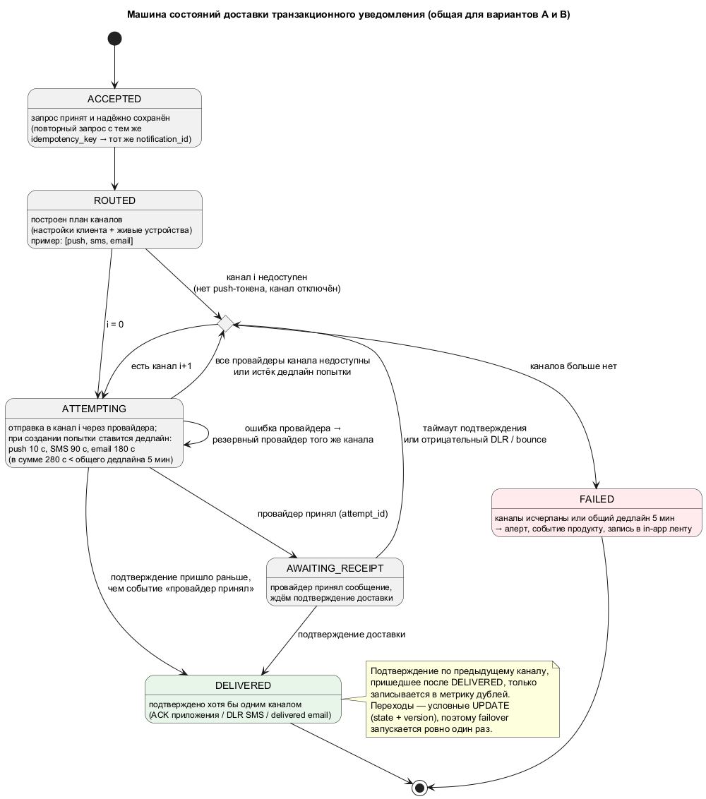
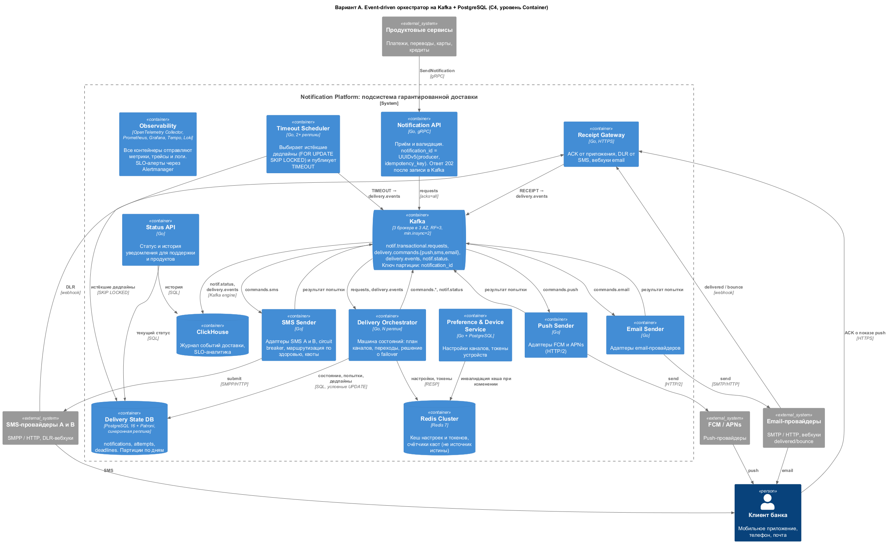
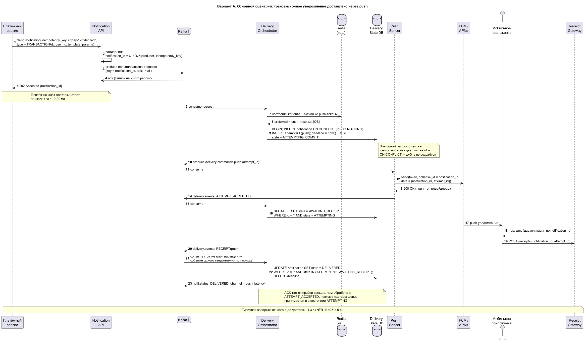
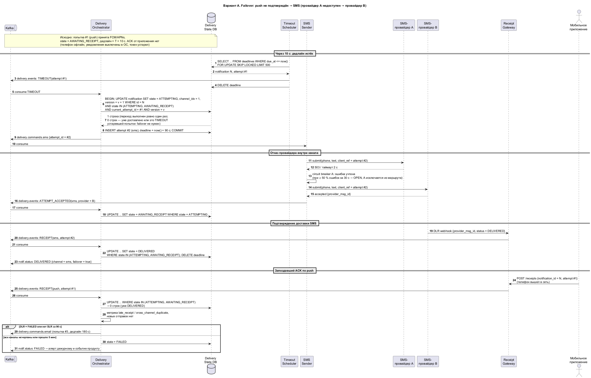
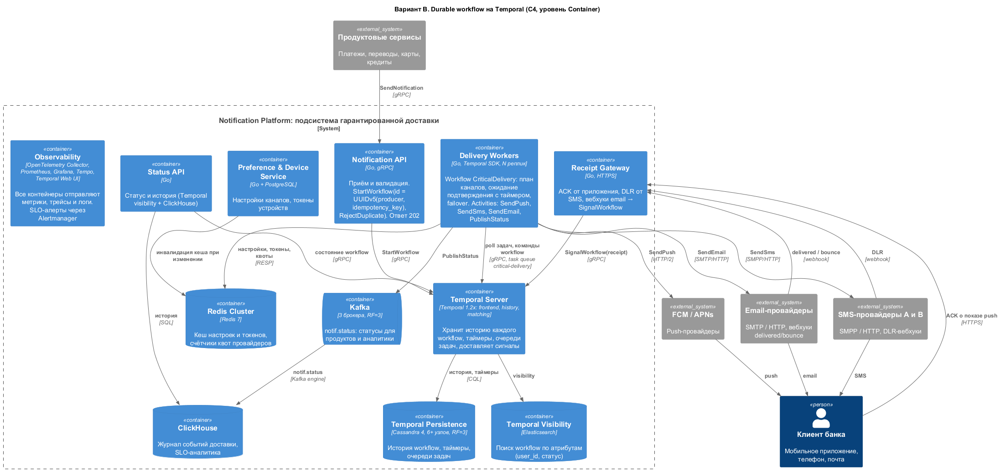
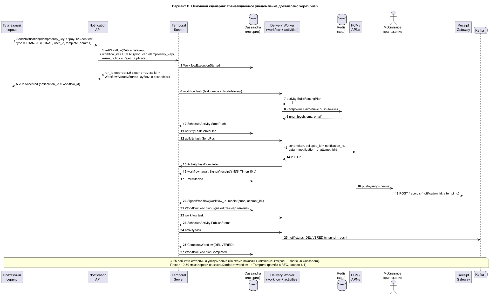
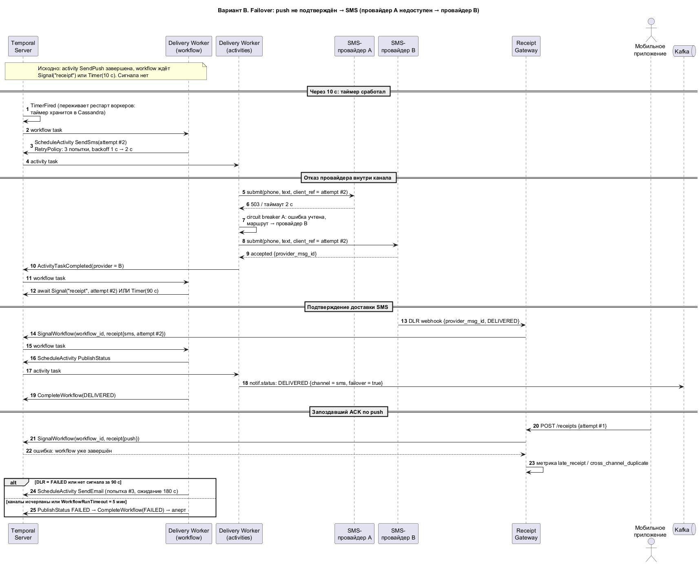

# RFC-001. Гарантированная доставка критичных уведомлений с кросс-канальным failover

| | |
|---|---|
| **Статус** | Предложено (Proposed) |
| **Автор** | Казанцев Демид Александрович |
| **Дата** | 17.11.2026 |
| **Область** | Notification Platform → подсистема доставки транзакционных уведомлений |
| **Связанные документы** | [1-requirements.md](1-requirements.md): требования и ASR всей платформы (задания 1–7) |

## Содержание
1. [Контекст и проблема](#1-контекст-и-проблема)
2. [Цели и не-цели](#2-цели-и-не-цели)
3. [Термины](#3-термины)
4. [Требования к подсистеме](#4-требования-к-подсистеме)
5. [ASR и приоритеты](#5-asr-и-приоритеты)
6. [Масштаб и расчёт нагрузки](#6-масштаб-и-расчёт-нагрузки)
7. [Политика доставки (общая для всех вариантов)](#7-политика-доставки-общая-для-всех-вариантов)
8. [Вариант A. Event-driven оркестратор на Kafka + PostgreSQL](#8-вариант-a-event-driven-оркестратор-на-kafka--postgresql)
9. [Вариант B. Durable workflow на Temporal](#9-вариант-b-durable-workflow-на-temporal)
10. [Отклонённый вариант C. Параллельная отправка во все каналы](#10-отклонённый-вариант-c-параллельная-отправка-во-все-каналы)
11. [Сравнение и trade-off](#11-сравнение-и-trade-off)
12. [Решение и обоснование](#12-решение-и-обоснование)
13. [Ключевые компромиссы и ограничения](#13-ключевые-компромиссы-и-ограничения)
14. [Наблюдаемость](#14-наблюдаемость)
15. [Риски и открытые вопросы](#15-риски-и-открытые-вопросы)
16. [План внедрения](#16-план-внедрения)
17. [Приложение: модель данных и контракт](#17-приложение-модель-данных-и-контракт)

---

## 1. Контекст и проблема

Сейчас каждая продуктовая команда банка отправляет уведомления сама. Транзакционные уведомления (списание, зачисление, подтверждение перевода) иногда не доходят или дублируются, а централизованного контроля доставки нет.

Для критичных уведомлений это неприемлемо:
- клиент, не узнавший о списании, поздно замечает мошенничество;
- банк обязан информировать клиента об операциях (161-ФЗ, ст. 9).

Каналы различаются по надёжности, стоимости и задержке:

| Канал | Задержка (типично) | Стоимость | Подтверждение доставки | Типовые отказы |
|---|---|---|---|---|
| **Push** (FCM/APNs) | 0,5–3 с | ≈ 0 | Провайдер подтверждает только приём. Факт показа подтверждает лишь само приложение (ACK) | Устаревший токен, уведомления выключены в ОС, телефон офлайн |
| **SMS** | 3–30 с | ≈ 3 ₽ за сообщение (допущение) | DLR от оператора: приходит не всегда и с задержкой | Отказ провайдера, лимит TPS, задержки у отдельных операторов |
| **Email** | 5 с – минуты | ≈ 0,05 ₽ | Вебхук delivered (принято почтовым сервером получателя) или bounce | Спам-фильтры, переполненный ящик, клиент редко читает почту |

Нужна подсистема, которая гарантирует доставку хотя бы по одному каналу, сама переключается на резервный канал, учитывает настройки клиента, экономит на SMS, не плодит дубли и прозрачна для мониторинга.

## 2. Цели и не-цели

**Цели:**
1. Доставить каждое принятое транзакционное уведомление хотя бы по одному каналу и подтвердить доставку.
2. Автоматически переключаться между провайдерами внутри канала и между каналами (push → SMS → email).
3. Учитывать настройки клиента: предпочтительный канал, копия на email.
4. Держать долю SMS не выше 30 % транзакционных доставок.
5. Не допускать дублей сверх SLO и дать полную наблюдаемость каждого уведомления.

**Не-цели** (решаются другими частями платформы):
- массовые маркетинговые кампании, сегментация, лимиты частоты маркетинга;
- редактор шаблонов и локализация (подсистема получает уже готовый шаблон и параметры);
- центр настроек как продукт: подсистема только читает настройки;
- голосовые звонки и мессенджеры как каналы. Архитектура должна позволять их добавить, но в этой версии их нет.

## 3. Термины

| Термин | Значение |
|---|---|
| **Уведомление** (`notification_id`) | Одно бизнес-событие для одного клиента, например «списание 1 500 ₽ по карте *1234». Идентификатор детерминирован: `UUIDv5(producer, idempotency_key)` |
| **Попытка** (`attempt_id`) | Одна отправка уведомления в конкретный канал через конкретного провайдера |
| **Доставлено** | Получено подтверждение: **push** — ACK от приложения после показа; **SMS** — DLR со статусом DELIVERED; **email** — вебхук delivered (принято сервером получателя). «Провайдер принял» доставкой **не считается** |
| **Failover провайдера** | Переход на резервного провайдера того же канала (SMS A → SMS B). Срабатывает при ошибке отправки |
| **Failover канала** | Переход на следующий канал плана (push → SMS). Срабатывает по таймауту подтверждения или отрицательному DLR |
| **DLR** | Delivery Report — отчёт оператора о доставке SMS |
| **ACK** | Подтверждение от мобильного приложения, что push получен и показан. На iOS отправляется из Notification Service Extension, на Android — из обработчика `onMessageReceived` |

## 4. Требования к подсистеме

Детализация требований платформы ([1-requirements.md](1-requirements.md)) для подсистемы гарантированной доставки.

### 4.1. Функциональные

| ID | Требование | Из платформы |
|---|---|---|
| **R-F1** | Подсистема принимает транзакционное уведомление от продуктового сервиса и подтверждает приём только после надёжного сохранения. Повторный запрос с тем же ключом события не создаёт второе уведомление. | FR-1, FR-4 |
| **R-F2** | Подсистема строит план каналов для каждого уведомления по настройкам клиента и доступности каналов (есть ли живой push-токен, номер телефона, email). | FR-2, FR-3 |
| **R-F3** | Если канал не подтвердил доставку за отведённое время или вернул ошибку доставки, подсистема переходит к следующему каналу плана, пока не получит подтверждение или не исчерпает каналы. | FR-2 |
| **R-F4** | При ошибке провайдера подсистема повторяет отправку через резервного провайдера того же канала. | FR-2 |
| **R-F5** | Транзакционные уведомления нельзя отключить. Клиент может выбрать предпочтительный канал (push или SMS) и включить копию на email. Тихие часы на транзакционные не действуют. | FR-3 |
| **R-F6** | Если доставить не удалось ни по одному каналу, подсистема фиксирует статус FAILED, уведомляет дежурных и продуктовый сервис, кладёт уведомление в ленту уведомлений в приложении. | FR-2, FR-8 |
| **R-F7** | Подсистема публикует статус каждого уведомления (принято → отправлено → доставлено/не доставлено, по какому каналу) и даёт историю попыток для поддержки. | FR-8 |

### 4.2. Нефункциональные

| ID | Требование | Из платформы |
|---|---|---|
| **R-N1** | Задержка от приёма до подтверждённой доставки: p95 ≤ 5 с, p99 ≤ 10 с по первому каналу; с failover p95 ≤ 30 с. Подтверждение приёма (ответ API) — p99 ≤ 100 мс. | NFR-1 |
| **R-N2** | ≥ 99,95 % уведомлений подтверждены за ≤ 5 мин (среди клиентов, достижимых хотя бы по одному каналу). Ни одно принятое уведомление не теряется (RPO = 0). | NFR-2 |
| **R-N3** | Доступность приёма — 99,95 %. Отказ одной зоны доступности (AZ) не останавливает доставку. | NFR-3 |
| **R-N4** | Пик — 1 000 уведомлений/с, запас по мощности — до 2 000/с без изменения архитектуры. | NFR-4 |
| **R-N5** | Отказ провайдера обнаруживается и обходится за ≤ 30 с. | NFR-5 |
| **R-N6** | Дубли в одном канале ≤ 0,01 %, двойная доставка из-за failover ≤ 1 %. | NFR-6 |
| **R-N7** | Доля SMS ≤ 30 % транзакционных доставок. | NFR-8 |
| **R-N8** | Статус виден ≤ 5 с после события. 100 % уведомлений трассируются. Алерт о нарушении SLO срабатывает за ≤ 1 мин. | NFR-7 |

## 5. ASR и приоритеты

Взяты из платформенных ASR ([1-requirements.md, раздел 3](1-requirements.md#3-архитектурно-значимые-требования-asr)) и уточнены для подсистемы. При конфликте выигрывает ASR с более высоким приоритетом.

| Приоритет | ASR | Требования | Что значит для подсистемы |
|---|---|---|---|
| **1** | **ASR-1. Гарантированная доставка** | R-F1, R-F3, R-F4, R-F6, R-N2, R-N3 | Надёжное хранение принятого запроса, машина состояний на каждое уведомление, надёжные таймеры, подтверждения доставки |
| **2** | **ASR-2. Низкая задержка** | R-N1, R-N4 | Минимум переходов на пути, без пакетирования, быстрый пропуск недоступных каналов |
| **3** | **ASR-4. Устойчивость к провайдерам** | R-F4, R-N5 | Несколько провайдеров на канал, circuit breaker, маршрутизация по здоровью |
| **4** | **ASR-5. Без дублей** | R-F1, R-N6 | Идемпотентность приёма и отправки, условные переходы, ключ схлопывания на клиенте |
| **5** | **ASR-C. Стоимость** (новый, специфичный для подсистемы) | R-N7, R-F2 | Push-first, SMS только как резерв или по выбору клиента |
| **6** | **ASR-6. Наблюдаемость** | R-F7, R-N8 | События по каждому переходу, сквозная трассировка, SLO-метрики |
| **7** | **ASR-3. Изоляция от массового трафика** | R-N1, R-N4 | Свои топики, обработчики и квоты провайдеров для транзакционных |

Почему **гарантия выше задержки**: опоздавшее на 20 секунд SMS о списании лучше, чем быстрый push, который никто не увидел. Почему **дубли выше стоимости**: лишние SMS стоят денег, а дубли рождают жалобы (цель «−30 % жалоб»), так что при выборе таймаута не экономим на точности.

## 6. Масштаб и расчёт нагрузки

### 6.1. Поток транзакционных уведомлений

| Величина | Расчёт | Значение |
|---|---|---|
| Транзакционных в сутки | 3 млн DAU × 2 | **6 млн/сут** |
| Средний поток | 6 млн / 86 400 с | ≈ 70/с |
| Средний поток в активные часы | 80 % суточного объёма за 14 ч (08:00–22:00): 4,8 млн / 50 400 с | ≈ 95/с |
| Пиковый час | × 3 к активному часу (обед, вечер, зарплатный день) | ≈ 290/с |
| Секундные всплески | × 3 к пиковому часу | ≈ 860/с → **расчётный пик 1 000/с** |
| Проверка через одновременных пользователей | 300 тыс. онлайн × 1 транзакционное уведомление раз в 5 мин = 300 000 / 300 с | **1 000/с** (сходится) |
| Целевая мощность | пик × 2 (запас на рост и аномалии) | **2 000/с** |

### 6.2. Распределение по каналам и стоимость

Допущения (проверяются пилотом, см. раздел 15): **75 %** активных клиентов имеют рабочий push (токен жив, уведомления разрешены). Из них **95 %** присылают ACK за 10 с.

| Величина | Расчёт | Значение |
|---|---|---|
| Доставлено через push | 75 % × 95 % | **≈ 71 %** |
| Ушло в SMS (нет push или нет ACK) | 100 % − 71 % | **≈ 29 %** (цель R-N7 ≤ 30 %: выполнено) |
| Дошло до email | недоставленные SMS (≈ 3–5 % от SMS) | ≈ 1 % |
| Пиковый поток push | 1 000/с × 75 % | ≈ 750/с (квота FCM — 600 тыс./мин ≈ 10 000/с: с запасом) |
| Пиковый поток SMS | 1 000/с × 29 % | **≈ 290 SMS/с** — больше типичного лимита одного аккаунта (50–200 TPS). Нужны 2 провайдера и зарезервированная квота ≈ 600 TPS |
| Входящие ACK | 1 000/с × 71 % | ≈ 710 HTTPS-запросов/с в Receipt Gateway |
| SMS в сутки | 6 млн × 29 % | ≈ 1,74 млн |
| **Стоимость SMS, push-first** | 1,74 млн × 3 ₽ | ≈ **5,2 млн ₽/сут ≈ 157 млн ₽/мес** |
| Стоимость, если всё по SMS (или вариант C) | 6 млн × 3 ₽ | ≈ 18 млн ₽/сут ≈ **540 млн ₽/мес** |
| **Экономия push-first** | | **≈ 383 млн ₽/мес (−71 %)** |

### 6.3. Нагрузка на компоненты (вариант A)

| Компонент | Расчёт | Пик (1 000 уведомлений/с) | Целевая мощность (2 000/с) |
|---|---|---|---|
| Kafka, сообщений | ≈ 5 сообщений на уведомление без failover (запрос, команда, результат, ACK, статус), ≈ 8 с failover; в среднем 5 × 0,71 + 8 × 0,29 ≈ 5,9 | ≈ 6 000 сообщений/с × ~1 КБ ≈ 6 МБ/с (18 МБ/с с RF = 3) | 12 000/с, 36 МБ/с — для 3 брокеров это единицы процентов возможностей |
| PostgreSQL, транзакций | ≈ 3 транзакции без failover (создание; «принято провайдером»; «доставлено»), ≈ 6 с failover; в среднем ≈ 3,9 | ≈ 4 000 tx/с, ≈ 8 000 изменённых строк/с | ≈ 8 000 tx/с — близко к потолку одного primary. Запас: пакетная запись по батчу Kafka, затем шардирование по `notification_id` на 2–4 узла |
| Таймеры | создаётся по одному на попытку, срабатывает ≈ 29 % (только при failover) | ≈ 1 300 создано/с, ≈ 300 сработало/с | ×2 |
| Хранение | ≈ 2,5 КБ на уведомление в PostgreSQL (строка, попытки, индексы) | 6 млн × 2,5 КБ ≈ **15 ГБ/сут**; оперативное окно 7 дней ≈ 105 ГБ | история 90 дней в ClickHouse: ≈ 6 событий × 0,3 КБ × 6 млн ≈ 11 ГБ/сут, после сжатия ~2 ГБ/сут → ≈ 180 ГБ; архив 5 лет ≈ 3,6 ТБ |

### 6.4. Нагрузка на компоненты (вариант B, Temporal)

| Компонент | Расчёт | Пик (1 000 workflow/с) |
|---|---|---|
| События истории | ≈ 25 событий на workflow без failover (старт, ~4 workflow task × 3 события, 3 activity × 3 события, таймер, сигнал, завершение), ≈ 37 с failover; в среднем ≈ 28 | **≈ 28 000 событий/с** записи в persistence |
| Переходы состояния (state transitions) | ≈ 8–10 на workflow | ≈ 9 000/с — по ориентирам Temporal это кластер с ~10+ подами history-сервиса и 9–12 узлами Cassandra |
| Хранение истории | ≈ 20 КБ на workflow × 6 млн | ≈ 120 ГБ/сут; при хранении 3 дня и RF = 3 ≈ 1,1 ТБ |
| Задержка | ~10–30 мс на каждый оборот workflow ↔ Temporal, ~3 оборота до отправки push | +50–100 мс к пути: в бюджет 5 с укладывается |

**Вывод по нагрузке:** оба варианта укладываются в SLA. Но вариант B требует примерно в 7 раз больше операций записи на уведомление (≈ 28 событий истории против ≈ 4 транзакций БД) и тяжёлый кластер Temporal с Cassandra и Elasticsearch.

## 7. Политика доставки (общая для всех вариантов)

### 7.1. План каналов

| Ситуация | План каналов | Таймаут подтверждения |
|---|---|---|
| Предпочтение push (по умолчанию), есть устройство с поддержкой ACK | push → SMS → email | 10 с → 90 с → 180 с |
| Предпочтение push, но живого push-токена нет | SMS → email | 90 с → 180 с |
| Клиент выбрал SMS | SMS → push → email | 90 с → 10 с → 180 с |
| Нет подтверждённого номера телефона | push → email | 10 с → 180 с |
| Включена «копия на email» | email отправляется **параллельно** основному плану и не участвует в failover | — |

- Сумма таймаутов (280 с) меньше общего дедлайна 5 минут, поэтому все каналы успевают отработать.
- Устройство со старой версией приложения без ACK отмечено в реестре флагом `supports_ack = false`. Для него push отправляется, а SMS — безусловно через 10 с. Это дороже, поэтому стимулируем обновление приложения.
- Тихие часы и лимиты частоты к транзакционным не применяются.

### 7.2. Машина состояний



Исходник: [diagrams/delivery-state-machine.puml](diagrams/delivery-state-machine.puml)

### 7.3. Защита от дублей (одинакова по смыслу в обоих вариантах)

| Где возникает дубль | Защита |
|---|---|
| Продуктовый сервис повторил запрос (таймаут, retry) | `notification_id = UUIDv5(producer, idempotency_key)`, уникальность в хранилище (A: `INSERT … ON CONFLICT DO NOTHING`; B: `WorkflowIdReusePolicy = RejectDuplicate`) |
| Повторная обработка сообщения или задачи после сбоя обработчика | Результат каждого шага записан до подтверждения. Повторная обработка видит, что попытка уже есть, и не отправляет заново |
| Повтор отправки тому же провайдеру | `attempt_id` передаётся как `client_ref` (SMS) или `apns-collapse-id` / `collapse_key` (push). Провайдер и приложение схлопывают повторы |
| Два обработчика одновременно решили переключить канал или пришёл TIMEOUT устаревшей попытки | Условный переход `WHERE state IN (ATTEMPTING, AWAITING_RECEIPT) AND current_attempt_id = :attempt AND version = :v` (A) или однопоточное выполнение workflow (B): failover происходит ровно один раз |
| Подтверждение по push пришло **после** того, как ушло SMS | **Полностью исключить нельзя** (это ограничение модели, см. раздел 13). Минимизируем таймаутом push, калиброванным по распределению времени ACK, и считаем метрику `cross_channel_duplicate` (SLO ≤ 1 %) |

### 7.4. Failover провайдеров внутри канала

- У SMS два провайдера, у email два. У push по одному провайдеру на платформу: FCM для Android, APNs для iOS; резервом для push служит канал SMS.
- **Circuit breaker на провайдера:** OPEN при ≥ 50 % ошибок или p95 > 3 с за окно 30 с (не меньше 20 запросов). Через 15 с — HALF_OPEN и пробный трафик. Так отказ провайдера обходится за ≤ 30 с (R-N5).
- **Маршрутизация по здоровью и квоте:** основной провайдер получает трафик, пока здоров и не исчерпал TPS-квоту, излишек уходит резервному.
- **Повтор у другого провайдера только при явной ошибке отправки** (5xx, таймаут соединения, отказ в приёме). Если провайдер принял SMS, но DLR нет, SMS **не** переотправляется через другого провайдера: это гарантированный дубль. Вместо этого после таймаута подключается следующий канал (email).

---

## 8. Вариант A. Event-driven оркестратор на Kafka + PostgreSQL

### 8.1. Идея

Все шаги доставки — это события в Kafka с ключом партиции `notification_id`. Поэтому события одного уведомления обрабатываются строго по порядку одним экземпляром оркестратора. Состояние уведомления (машина состояний) и дедлайны хранятся в PostgreSQL. Отдельный Timeout Scheduler находит истёкшие дедлайны и публикует событие TIMEOUT. Отправкой в каждый канал занимаются отдельные stateless-отправители с адаптерами провайдеров.

### 8.2. Диаграмма C4 (Container)



Исходник: [diagrams/a-c4-container.puml](diagrams/a-c4-container.puml)

| Контейнер | Ответственность | Технология | Масштабирование |
|---|---|---|---|
| Notification API | Приём, валидация, вычисление `notification_id`, запись в Kafka | Go, gRPC | stateless, 3+ реплики (по 1 на AZ), HPA |
| Kafka | Надёжный журнал всех событий доставки | Apache Kafka 3.7 (KRaft), 3+ брокера в 3 AZ, RF = 3, `min.insync.replicas = 2`, идемпотентный producer, `acks = all` | партиции: requests 48, delivery.events 48, commands.* по 24 |
| Delivery Orchestrator | Машина состояний: план каналов, переходы, решение о failover | Go | по одной реплике на группу партиций, до 48 реплик |
| Delivery State DB | Уведомления, попытки, дедлайны | PostgreSQL 16, Patroni, 1 primary + синхронная реплика + асинхронная, в 3 AZ. Партиции по дням (pg_partman), оперативное окно 7 дней | вертикально, затем шардирование по `hash(notification_id)` |
| Timeout Scheduler | `SELECT … FOR UPDATE SKIP LOCKED` по индексу `due_at`, публикация TIMEOUT | Go | 2+ реплики работают параллельно без конфликтов благодаря SKIP LOCKED |
| Push / SMS / Email Sender | Адаптеры провайдеров, circuit breaker, ретраи, квоты | Go, HTTP/2 (APNs, FCM), SMPP/HTTP (SMS), SMTP/HTTP (email) | stateless, независимо по каналу |
| Receipt Gateway | Приём ACK от приложений, DLR и вебхуков провайдеров; проверка подписи (HMAC) и аутентификации | Go, HTTPS | stateless, 3+ реплики |
| Preference & Device Service | Настройки каналов, токены устройств | Go + PostgreSQL | — |
| Redis Cluster | Кеш настроек и токенов (TTL 60 с + инвалидация по событию), счётчики квот провайдеров | Redis 7 Cluster | шардирование |
| Status API + ClickHouse | Статус и история уведомления, SLO-аналитика | Go, ClickHouse (Kafka engine) | — |
| Observability | Метрики, трейсы, логи, алерты | OpenTelemetry, Prometheus, Grafana, Tempo, Loki, Alertmanager | — |

### 8.3. Основной сценарий (доставка через push)



Исходник: [diagrams/a-seq-main.puml](diagrams/a-seq-main.puml)

### 8.4. Сценарий failover (push → SMS, провайдер A → провайдер B)



Исходник: [diagrams/a-seq-failover.puml](diagrams/a-seq-failover.puml)

### 8.5. Как вариант A выполняет ASR

| ASR | Как выполняется |
|---|---|
| **ASR-1. Гарантия** | API отвечает 202 только после записи в Kafka (`acks = all`, `min.insync = 2`): принятое уведомление переживает отказ брокера и целой AZ. Состояние и дедлайны в PostgreSQL с синхронной репликой (RPO = 0). Таймеры — строки в БД, которые переживают рестарт любого сервиса. Потребители коммитят offset только после записи результата, поэтому сбой обработчика ведёт к повторной обработке, а не к потере. |
| **ASR-2. Задержка** | Путь «API → Kafka → Orchestrator → Kafka → Push Sender → FCM» — это 2 записи в Kafka и 1 транзакция БД, ≈ 30–60 мс внутри платформы. Настройки и токены берутся из Redis. Нет живого токена — push пропускается сразу, без ожидания таймаута. |
| **ASR-4. Провайдеры** | Адаптер на провайдера, circuit breaker, маршрутизация по здоровью и квоте, отдельный пул соединений на провайдера (bulkhead). Отказ провайдера не влияет на другие каналы: у каждого канала своя группа отправителей. |
| **ASR-5. Дубли** | Детерминированный `notification_id` + `ON CONFLICT DO NOTHING`. Все события уведомления в одной партиции, поэтому обрабатываются последовательно. Условные UPDATE по `state` + `version` — второй уровень защиты. `attempt_id` передаётся провайдерам. |
| **ASR-C. Стоимость** | Push-first, SMS — только как резерв. Расчёт: ≈ 29 % SMS. |
| **ASR-6. Наблюдаемость** | Каждый переход — событие в `notif.status` → ClickHouse (история 90 дней) и Status API. `trace_id` передаётся в заголовках Kafka. Метрики SLO — в разделе 14. |
| **ASR-3. Изоляция** | Отдельные топики и группы потребителей только для транзакционных. Квота SMS-провайдеров зарезервирована под транзакционные, маркетинг её не использует. |

### 8.6. Плюсы и минусы

| Плюсы | Минусы |
|---|---|
| Стандартный для банка стек (Kafka, PostgreSQL, Redis): есть экспертиза и эксплуатация | Машину состояний, таймеры и идемпотентность пишем сами: больше кода, выше риск ошибок |
| Лёгкий путь данных: ≈ 4 транзакции БД и ≈ 6 сообщений Kafka на уведомление | Логика переключения распределена между оркестратором и планировщиком: сложнее читать, чем один workflow |
| Приём (API → Kafka) не зависит от БД: при сбое PostgreSQL запросы копятся в Kafka и дообрабатываются после восстановления | Один primary PostgreSQL — потолок записи (≈ 8 000 tx/с при 2 000 уведомлений/с). Дальше нужно шардирование |
| Каждый компонент масштабируется независимо | Наблюдаемость отдельного уведомления нужно собирать самим (ClickHouse + Status API) |

---

## 9. Вариант B. Durable workflow на Temporal

### 9.1. Идея

Каждое транзакционное уведомление — отдельный workflow `CriticalDelivery` в Temporal. Логика доставки пишется как обычный последовательный код: «отправь push → жди сигнал подтверждения или таймер 10 с → иначе отправь SMS → …». Temporal сам сохраняет историю, таймеры, ретраи activity и восстанавливает выполнение после падения воркера.

Пример логики workflow (псевдокод):

```go
func CriticalDelivery(ctx workflow.Context, n Notification) (Status, error) {
    plan := execute(ctx, BuildRoutingPlan, n)           // настройки + устройства
    for _, step := range plan {                          // [push 10s, sms 90s, email 180s]
        attempt, err := execute(ctx, Send(step.Channel), n) // внутри — failover провайдеров
        if err != nil { continue }                       // канал недоступен → следующий
        if receipt := awaitSignal(ctx, "receipt", attempt.ID, step.Timeout); receipt.Delivered {
            execute(ctx, PublishStatus, DELIVERED, step.Channel)
            return DELIVERED, nil
        }
    }
    execute(ctx, PublishStatus, FAILED)                  // + алерт, лента в приложении
    return FAILED, nil
}
// WorkflowRunTimeout = 5 мин; task queue "critical-delivery" обслуживают только транзакционные воркеры
```

### 9.2. Диаграмма C4 (Container)



Исходник: [diagrams/b-c4-container.puml](diagrams/b-c4-container.puml)

| Контейнер | Ответственность | Технология |
|---|---|---|
| Notification API | Приём, `StartWorkflow(id = notification_id, RejectDuplicate)` | Go, gRPC |
| Temporal Server | История workflow, таймеры, очереди задач, сигналы | Temporal 1.2x (frontend, history, matching), 512 history-шардов |
| Temporal Persistence | Хранилище истории и таймеров | Cassandra 4, 9–12 узлов в 3 AZ, RF = 3, `LOCAL_QUORUM` |
| Temporal Visibility | Поиск workflow по атрибутам (`user_id`, статус) для поддержки | Elasticsearch |
| Delivery Workers | Код workflow и activities: SendPush, SendSms, SendEmail, PublishStatus | Go, Temporal SDK, отдельная task queue `critical-delivery` |
| Receipt Gateway | ACK, DLR, вебхуки → `SignalWorkflow` | Go, HTTPS |
| Preference & Device Service, Redis | Как в варианте A | Go + PostgreSQL, Redis 7 |
| Kafka + ClickHouse + Status API | Публикация статусов продуктам, аналитика | Kafka, ClickHouse, Go |
| Observability | Как в A + Temporal Web UI (история каждого workflow) | OpenTelemetry, Prometheus, Grafana, Tempo |

### 9.3. Основной сценарий (доставка через push)



Исходник: [diagrams/b-seq-main.puml](diagrams/b-seq-main.puml)

### 9.4. Сценарий failover (push → SMS, провайдер A → провайдер B)



Исходник: [diagrams/b-seq-failover.puml](diagrams/b-seq-failover.puml)

### 9.5. Как вариант B выполняет ASR

| ASR | Как выполняется |
|---|---|
| **ASR-1. Гарантия** | `StartWorkflow` подтверждается после записи в Cassandra (`LOCAL_QUORUM`, RF = 3). Таймеры и состояние хранит Temporal: падение воркера не теряет workflow, выполнение продолжается на другом воркере. Ретраи activity настраиваются декларативно. |
| **ASR-2. Задержка** | ≈ 3 оборота workflow ↔ Temporal до отправки push (+50–100 мс). В бюджет 5 с укладывается, но запас меньше, чем у A, и задержка зависит от нагрузки на Cassandra. |
| **ASR-4. Провайдеры** | Внутри activity SendSms — тот же circuit breaker и маршрутизация, плюс RetryPolicy Temporal. |
| **ASR-5. Дубли** | `workflow_id = notification_id` с `RejectDuplicate`: дубль запроса отклоняется самим Temporal. Код workflow выполняется детерминированно и однопоточно, гонки «двух failover» нет. Activity выполняется как минимум один раз, поэтому `attempt_id` передаётся провайдеру. |
| **ASR-C. Стоимость** | Та же политика push-first. Но инфраструктура дороже: Temporal + Cassandra + Elasticsearch. |
| **ASR-6. Наблюдаемость** | Сильная сторона: полная история каждого уведомления в Temporal Web UI, поиск по атрибутам. Бизнес-статусы публикуются в Kafka → ClickHouse. |
| **ASR-3. Изоляция** | Отдельная task queue и пул воркеров. Но кластер Temporal общий для всех workflow: при его перегрузке страдают все. |

### 9.6. Плюсы и минусы

| Плюсы | Минусы |
|---|---|
| Логика failover — один читаемый последовательный код | Новый критичный компонент (Temporal) плюс две новые БД (Cassandra, Elasticsearch): нет экспертизы, долгий ввод в эксплуатацию |
| Таймеры, ретраи, восстановление после сбоев «из коробки» | ≈ 28 000 событий истории/с в пике: тяжёлый кластер, ≈ 1 ТБ истории |
| Встроенная история каждого уведомления | **Приём зависит от Temporal**: при недоступности кластера API не может принять уведомление (в A приём держится только на Kafka) |
| Легко расширять сложными сценариями (эскалация в звонок, подтверждение прочтения) | Ограничения детерминизма workflow и версионирование кода при изменениях логики |

---

## 10. Отклонённый вариант C. Параллельная отправка во все каналы

**Идея:** каждое транзакционное уведомление отправляется сразу в push, SMS и email без ожидания подтверждений. Логики failover нет, «хоть один канал да дойдёт».

**Почему отклонён:**
- **ASR-C (стоимость):** SMS уходит на 100 % уведомлений: ≈ 540 млн ₽/мес вместо ≈ 157 млн ₽/мес (раздел 6.2).
- **ASR-5 (дубли):** клиент получает каждое уведомление 2–3 раза, что прямо противоречит цели «−30 % жалоб».
- Гарантию это не даёт: без подтверждений система всё равно не знает, дошло ли уведомление. Отказ SMS-провайдера проходит незамеченным.

Подробные диаграммы для варианта C не приводятся, так как он отклонён уже на уровне ASR.

## 11. Сравнение и trade-off

Оценка: ✅ — выполняет с запасом, ⚠️ — выполняет с оговорками, ❌ — не выполняет.

| Критерий (приоритет) | A. Kafka + PostgreSQL | B. Temporal | C. Все каналы сразу |
|---|---|---|---|
| ASR-1 Гарантия (1) | ✅ Kafka + синхронная реплика БД, надёжные таймеры | ✅ Встроенная надёжность workflow | ⚠️ Нет подтверждений: не знаем, что дошло |
| ASR-2 Задержка (2) | ✅ ≈ 30–60 мс внутри платформы | ⚠️ +50–100 мс, зависит от нагрузки на Cassandra | ✅ |
| Доступность приёма (R-N3) | ✅ Зависит только от Kafka | ⚠️ Зависит от Temporal + Cassandra | ✅ |
| ASR-4 Провайдеры (3) | ✅ | ✅ | ⚠️ Отказ не замечается |
| ASR-5 Дубли (4) | ✅ Условные переходы + идемпотентность (свой код) | ✅ Встроено (RejectDuplicate, детерминизм) | ❌ Дубли в 100 % случаев |
| ASR-C Стоимость (5) | ✅ ≈ 29 % SMS, лёгкая инфраструктура | ⚠️ ≈ 29 % SMS, тяжёлая инфраструктура | ❌ 100 % SMS |
| ASR-6 Наблюдаемость (6) | ⚠️ Собираем сами (ClickHouse, Status API) | ✅ История workflow из коробки | ⚠️ |
| ASR-3 Изоляция (7) | ✅ Свои топики и квоты | ⚠️ Общий кластер Temporal | ✅ |
| Нагрузка на хранилище | ≈ 4 tx на уведомление | ≈ 28 событий истории на уведомление | минимальная |
| Объём собственного кода | больше: машина состояний, планировщик | меньше | минимальный |
| Новые технологии для команды | нет | Temporal, Cassandra, Elasticsearch | нет |
| Расширяемость сложными сценариями | ⚠️ Каждый новый сценарий — изменения в машине состояний | ✅ Обычный код workflow | ❌ |

**Главный trade-off между A и B:** A покупает лёгкую инфраструктуру, независимость приёма и знакомый стек ценой собственного кода машины состояний и таймеров. B покупает готовые надёжность, таймеры и наблюдаемость ценой нового тяжёлого компонента, через который проходит каждое критичное уведомление.

## 12. Решение и обоснование

**Выбран вариант A — event-driven оркестратор на Kafka + PostgreSQL.**

1. **Оба варианта закрывают ASR-1 (гарантию).** Решают ASR следующих приоритетов и эксплуатационные критерии. По задержке (ASR-2) и доступности приёма A лучше: приём держится только на Kafka. При сбое БД или оркестратора уведомления копятся в журнале и не теряются, а продуктовые сервисы этого не замечают. В B недоступность кластера Temporal останавливает приём критичных уведомлений.
2. **Нагрузка и стоимость инфраструктуры.** При 1 000–2 000 уведомлений/с A делает ≈ 4–8 тыс. транзакций/с в PostgreSQL. B делает ≈ 28–56 тыс. событий истории/с и требует кластер Cassandra на 9–12 узлов плюс Elasticsearch только под эту подсистему.
3. **Риск внедрения.** Kafka, PostgreSQL и Redis уже эксплуатируются в банке. Temporal добавил бы три новых критичных компонента и потребовал обучения команды и дежурных. Для подсистемы, от которой зависит информирование об операциях, это неоправданный риск.
4. **Сложность логики невелика.** Машина состояний из 6 состояний и 3 каналов — это несколько сотен строк кода, которые покрываются тестами. Главное преимущество Temporal (сложные долгие процессы) здесь используется слабо.

**Когда пересмотреть решение:** если в доставку добавятся многошаговые процессы (эскалация в звонок, ожидание подтверждения прочтения, согласование с антифродом) или собственная машина состояний начнёт давать дефекты, стоит перейти на вариант B. Граница «оркестратор ↔ отправители каналов» в A это позволяет: отправители и Receipt Gateway переиспользуются без изменений.

## 13. Ключевые компромиссы и ограничения

| # | Компромисс или ограничение | Что получаем | Чем платим | Как смягчаем |
|---|---|---|---|---|
| 1 | **Гарантия «как минимум один раз», а не «ровно один раз».** Exactly-once с внешними провайдерами невозможен | Ни одно уведомление не теряется | Возможны дубли | Идемпотентность на всех уровнях, SLO на дубли |
| 2 | **Таймаут push = 10 с** | Задержка с failover в пределах 30 с | Клиент с медленным интернетом получит и push, и SMS (кросс-канальный дубль) | Калибровка по распределению времени ACK (пилот). SLO ≤ 1 %. Запоздавший push приложение может сверить со статусом в платформе (Notification Service Extension) и не показывать, если уведомление уже доставлено по SMS |
| 3 | **«Доставлено» по push = ACK приложения** | Честная гарантия, а не «провайдер принял» | Нужна доработка приложений (iOS Notification Service Extension). Старые версии без ACK дороже (SMS безусловно) | Флаг `supports_ack` в реестре устройств, принудительное обновление |
| 4 | **Email как последний резерв** | Почти бесплатный канал на редкие случаи | «Доставлено» для email = принято почтовым сервером, а не прочитано | Email только как третий канал и копия, не основной |
| 5 | **Push-first экономит ≈ 71 % на SMS** | ≈ 383 млн ₽/мес экономии | Часть клиентов получает уведомление на ~10 с позже (после таймаута push) | Клиент может выбрать SMS как основной канал |
| 6 | **Свой код машины состояний и планировщика** | Лёгкая инфраструктура, независимость приёма | Риск ошибок в критичном коде | Тесты всех переходов, chaos-тесты (kill оркестратора и планировщика, отказ провайдера), алерт на «зависшие» уведомления (старше 5 мин не в терминальном состоянии) |
| 7 | **Один primary PostgreSQL** | Простота и строгая согласованность | Потолок ≈ 8–10 тыс. tx/с, это около ×2 от расчётного пика | Пакетная запись, затем шардирование по `notification_id` (уже заложен ключ) |
| 8 | **Гарантия ограничена достижимостью клиента.** Если у клиента нет push, телефон выключен и нет email, доставить физически нельзя | Честный SLO (знаменатель — достижимые клиенты) | Часть уведомлений будет FAILED | Лента уведомлений в приложении, алерт, событие продукту |
| 9 | **Кеш настроек живёт до 60 с** | Нет нагрузки на БД настроек на каждое уведомление | Смена предпочтительного канала применяется не мгновенно | Для транзакционных это безопасно: канал меняется, а уведомление всё равно доставляется |

## 14. Наблюдаемость

### 14.1. SLI и SLO

| SLI | SLO | Алерт |
|---|---|---|
| Время от приёма до подтверждённой доставки (по первому каналу) | p95 ≤ 5 с, p99 ≤ 10 с | p95 > 5 с в течение 5 мин |
| Время доставки с failover | p95 ≤ 30 с | p95 > 30 с в течение 5 мин |
| Доля доставленных за 5 мин | ≥ 99,95 % | burn rate ×14 за 1 ч (быстрое сгорание бюджета ошибок) |
| Доля FAILED | ≤ 0,05 % | > 0,1 % за 10 мин |
| Доля кросс-канальных дублей (`late_receipt`) | ≤ 1 % | > 2 % за 1 ч |
| Доля SMS среди доставок | ≤ 30 % | > 35 % за 1 ч (признак проблем с push) |
| Лаг потребителей Kafka (transactional) | < 1 000 сообщений | > 5 000 или растёт 3 мин |
| «Зависшие» уведомления (не терминальные дольше 5 мин) | 0 | > 0 |
| Ошибки и задержка провайдера | error rate < 5 %, p95 < 3 с | переход circuit breaker в OPEN |

### 14.2. Инструменты

- **Метрики** (Prometheus): гистограммы задержки с метками `type`, `channel`, `provider`, `failover=true/false`; счётчики переходов машины состояний; состояние circuit breaker; квоты провайдеров.
- **Трейсы** (OpenTelemetry → Tempo): `trace_id` от продуктового сервиса через заголовки Kafka до вызова провайдера и обработки ACK. Один trace показывает всю жизнь уведомления.
- **Логи** (Loki): структурированные, с `notification_id`, `attempt_id` и `trace_id`; номера телефонов и суммы маскируются.
- **История для поддержки:** Status API (`GET /notifications/{id}`, `GET /users/{id}/notifications`) показывает таймлайн попыток из PostgreSQL (7 дней) и ClickHouse (90 дней).
- **Дашборды** (Grafana): воронка «принято → отправлено → доставлено» по каналам, доля failover, здоровье провайдеров, стоимость SMS в реальном времени.

## 15. Риски и открытые вопросы

| Риск / вопрос | Влияние | Проверка / смягчение |
|---|---|---|
| Реальная доля клиентов с рабочим push ниже 75 % | Доля SMS растёт, NFR по стоимости не выполняется | Выгрузка из реестра устройств. Пилот на 5 % трафика |
| Время ACK на iOS больше 10 с у значимой доли клиентов | Много кросс-канальных дублей и лишних SMS | Прототип Notification Service Extension, замер распределения, калибровка таймаута (возможно, отдельно для iOS и Android) |
| DLR приходит не от всех операторов | Лишние переходы на email, искажённая статистика | Двухнедельный замер по операторам. Для операторов без DLR — правило «принято провайдером = доставлено» с пониженной уверенностью |
| Лимиты TPS SMS-провайдеров меньше 300/с суммарно | Очередь на SMS в пике, нарушение SLA | Договор с двумя провайдерами и несколькими аккаунтами, нагрузочный тест |
| Регулятор потребует SMS для всех списаний | Push-first теряет экономический смысл | Заключение юристов до начала внедрения |
| Перегрузка PostgreSQL при росте выше ×2 | Рост задержки | Мониторинг tx/с, план шардирования заранее |

## 16. План внедрения

1. **Пилот (4 недели).** Транзакционные уведомления одного продукта (платежи по картам) на 5 % клиентов. Старая отправка работает параллельно, но клиенту уходит только одно сообщение. Замеры: доля ACK, время ACK, DLR, доля SMS, дубли. Калибровка таймаутов.
2. **Расширение (4 недели).** 100 % транзакционных уведомлений платежей и переводов. Chaos-тесты: отказ провайдера, kill оркестратора, отказ AZ.
3. **Миграция остальных команд.** Все транзакционные уведомления идут только через платформу. Прямые интеграции команд с провайдерами отключаются.
4. **Дальше:** сервисные и маркетинговые уведомления переходят на платформу (это отдельные подсистемы, вне этого RFC).

## 17. Приложение: модель данных и контракт

### 17.1. Delivery State DB (PostgreSQL, вариант A)

```sql
CREATE TYPE delivery_state AS ENUM ('ACCEPTED','ROUTED','ATTEMPTING','AWAITING_RECEIPT','DELIVERED','FAILED');
CREATE TYPE channel        AS ENUM ('PUSH','SMS','EMAIL');

CREATE TABLE notifications (
    id                uuid           NOT NULL,          -- UUIDv5(producer, idempotency_key)
    created_at        timestamptz    NOT NULL DEFAULT now(),
    producer          text           NOT NULL,
    idempotency_key   text           NOT NULL,
    user_id           bigint         NOT NULL,
    template_id       text           NOT NULL,
    params            jsonb          NOT NULL,
    plan              channel[]      NOT NULL,          -- например {PUSH,SMS,EMAIL}
    channel_idx       smallint       NOT NULL DEFAULT 0, -- текущий канал в плане
    current_attempt_id uuid,                            -- TIMEOUT устаревшей попытки игнорируется
    state             delivery_state NOT NULL,
    version           int            NOT NULL DEFAULT 0, -- для условных переходов
    delivered_channel channel,
    delivered_at      timestamptz,
    PRIMARY KEY (id, created_at)
) PARTITION BY RANGE (created_at);                       -- партиции по дням, хранение 7 дней

CREATE TABLE attempts (
    id               uuid        PRIMARY KEY,            -- attempt_id, передаётся провайдеру
    notification_id  uuid        NOT NULL,
    channel          channel     NOT NULL,
    provider         text,
    provider_msg_id  text,
    status           text        NOT NULL,              -- SENDING / ACCEPTED / DELIVERED / FAILED / TIMEOUT
    sent_at          timestamptz,
    result_at        timestamptz,
    error            text
);

CREATE TABLE deadlines (
    notification_id  uuid        NOT NULL,
    attempt_id       uuid        PRIMARY KEY,
    due_at           timestamptz NOT NULL
);
CREATE INDEX ON deadlines (due_at);                      -- для SKIP LOCKED-выборки планировщика
```

### 17.2. Контракт приёма (gRPC)

```protobuf
service NotificationService {
  // Возвращается после надёжной записи (Kafka acks=all). Не ждёт доставки.
  rpc SendNotification(SendNotificationRequest) returns (SendNotificationResponse);
}

message SendNotificationRequest {
  string idempotency_key = 1;          // ключ события у продюсера, например "pay-123:debited"
  NotificationType type = 2;           // TRANSACTIONAL | SERVICE | MARKETING
  int64 user_id = 3;
  string template_id = 4;              // "card_debit_v3"
  map<string, string> params = 5;      // {"amount": "1500.00", "card_last4": "1234"}
}

message SendNotificationResponse {
  string notification_id = 1;          // одинаковый для повторов с тем же idempotency_key
}
```

### 17.3. Топики Kafka (вариант A)

| Топик | Ключ | Партиций | Хранение | Что внутри |
|---|---|---|---|---|
| `notif.transactional.requests` | notification_id | 48 | 7 дней | Принятые запросы |
| `delivery.commands.push` / `.sms` / `.email` | notification_id | 24 | 1 день | Команды отправителям каналов |
| `delivery.events` | notification_id | 48 | 3 дня | ATTEMPT_ACCEPTED/FAILED, RECEIPT, TIMEOUT |
| `notif.status` | notification_id | 24 | 7 дней | Статусы для продуктов, ClickHouse и Status API |
